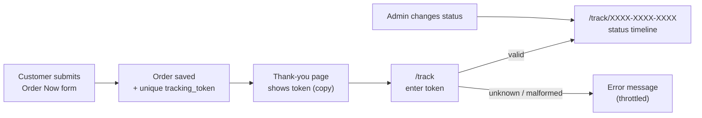
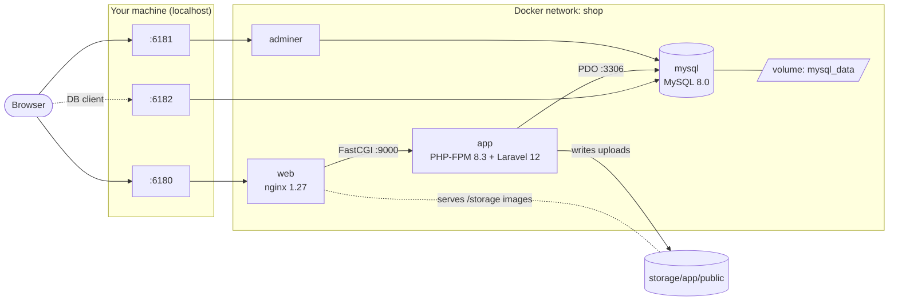
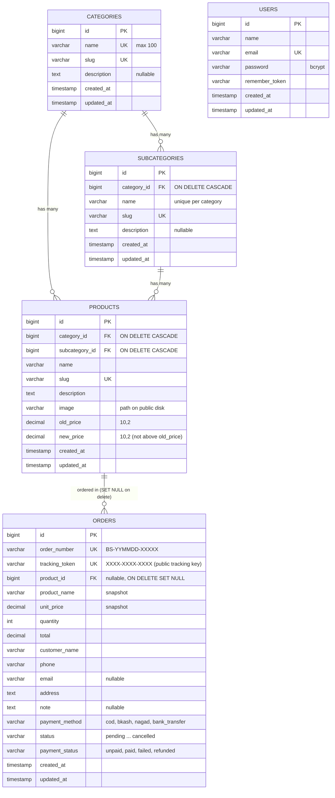
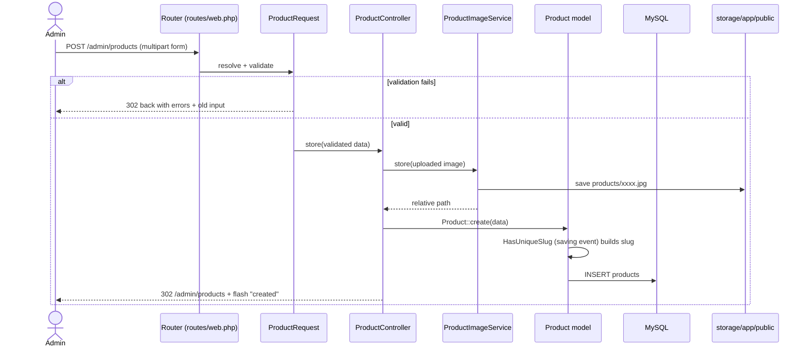
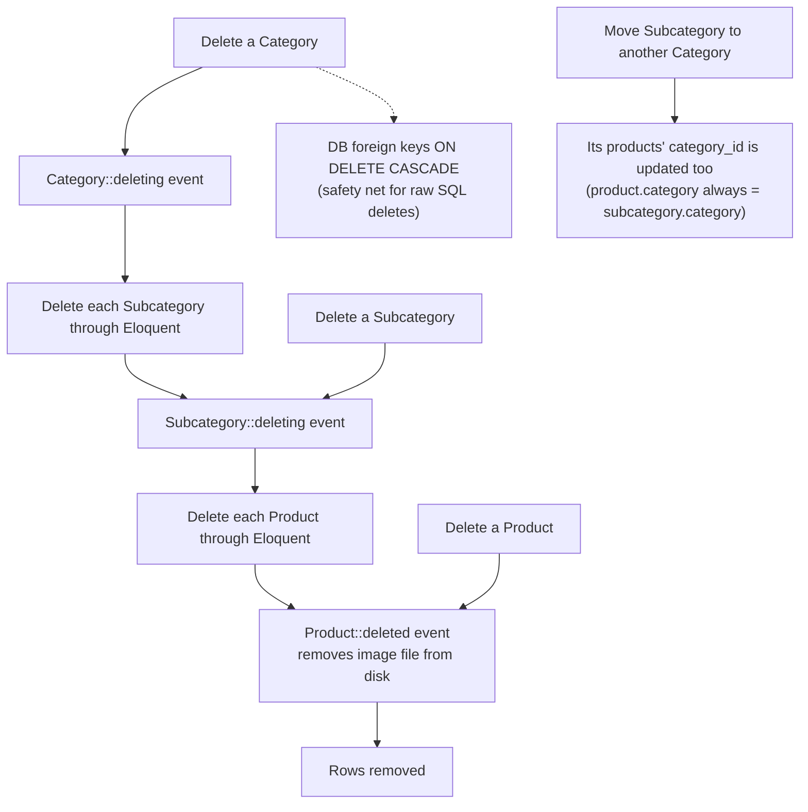
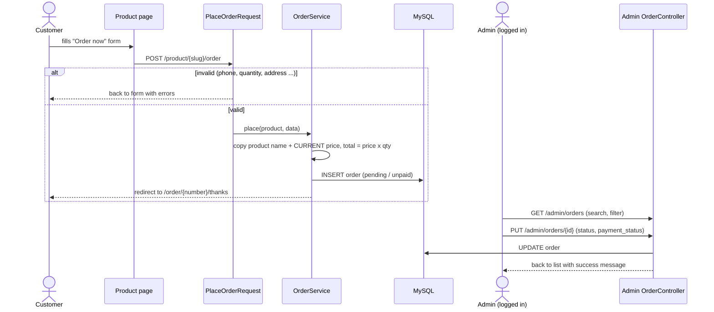
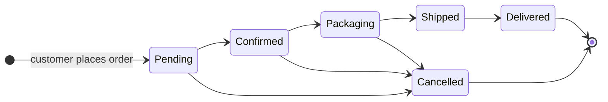
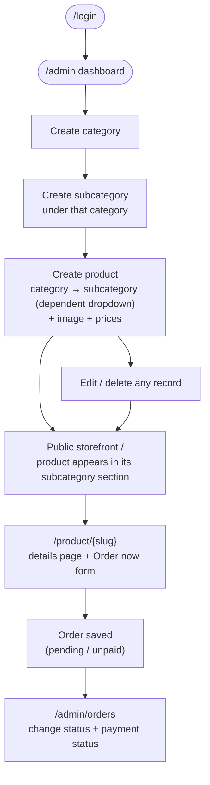

# Bangla Shop — Laravel E-commerce Platform

A simplified e-commerce platform built with **Laravel 12 / PHP 8.3 / MySQL 8** for the *Mid-Level Laravel Developer* assignment at Bangla Puzzle Limited.

It provides complete **CRUD for Categories, Subcategories and Products**, a public storefront that lists products **grouped by subcategory**, **SEO-friendly slug URLs**, image upload, form validation, **admin login**, a public **"Order Now"** form with an **admin order manager** (order status + payment status), a Docker environment, and an automated test suite.

| Service      | URL / Address              | Purpose                              |
|--------------|----------------------------|--------------------------------------|
| Application  | http://localhost:6180      | Storefront + admin panel (login: `admin@example.com` / `password`) |
| Adminer      | http://localhost:6181      | Database GUI                         |
| MySQL        | `localhost:6182`           | Direct DB access (TablePlus, CLI …)  |

## Quick reference (URLs, logins, setup in one place)

| What | Docker | Without Docker (`php artisan serve`) |
|------|--------|--------------------------------------|
| Website | http://localhost:6180 | http://127.0.0.1:8000 |
| Admin login (not linked from the shop, type the URL) | http://localhost:6180/login | http://127.0.0.1:8000/login |
| Admin panel | http://localhost:6180/admin | http://127.0.0.1:8000/admin |
| Admin account | `admin@example.com` / `password` | same |
| Order tracking | http://localhost:6180/track, demo tokens `DEMO-0001-TRK1` … `DEMO-0006-TRK6` | http://127.0.0.1:8000/track |
| Adminer (DB GUI) | http://localhost:6181, System **MySQL**, Server **mysql**, User **shop**, Password **secret**, Database **laravel_ecommerce** (or user `root` / password `root`) | use your own MySQL client |
| MySQL client | host `127.0.0.1`, port **6182**, user `shop`, password `secret` | your own MySQL (port 3306) |

**With Docker (recommended)**

```bash
docker compose up -d --build                    # 1. start (wait for "[entrypoint] ready" in: docker compose logs -f app)
docker compose exec app php artisan test        # 2. run the tests (optional)
docker compose exec app php artisan migrate:fresh --seed   # 3. clean database + demo data (optional)
```

**Without Docker** (PHP 8.2+ with `pdo_mysql, gd, mbstring, intl, zip, bcmath`, Composer 2, MySQL 8)

```bash
composer install
cp .env.example .env                 # set DB_DATABASE, DB_USERNAME, DB_PASSWORD
php artisan key:generate
mysql -u root -p -e "CREATE DATABASE laravel_ecommerce CHARACTER SET utf8mb4 COLLATE utf8mb4_unicode_ci"
php artisan migrate --seed           # or import database/sql/ecommerce.sql instead
php artisan storage:link
php artisan serve
```

**Good to know**

* The public shop has no link to the admin area by design; open `/login` directly.
* Tests use an in-memory SQLite database and never touch the MySQL data.
* A VPS deployment guide (Nginx, PHP-FPM, MySQL, HTTPS) is in [section 11](#11-vps-deployment-guide).
* A reference for every class and method is in [docs/CODE_DOCUMENTATION.md](docs/CODE_DOCUMENTATION.md).
* Suggested demo order: shop -> product -> **Order Now** -> copy the tracking token -> `/track` -> admin login -> change order status -> `php artisan test`.

---

## Table of contents

1. [Requirement checklist](#1-requirement-checklist)
2. [Quick start (Docker)](#2-quick-start-docker)
3. [Setup without Docker](#3-setup-without-docker)
4. [Application map](#4-application-map)
5. [Diagrams](#5-diagrams) — architecture, ER, request flow, delete rules, work process
6. [Project structure](#6-project-structure) — full code reference: **[docs/CODE_DOCUMENTATION.md](docs/CODE_DOCUMENTATION.md)**
7. [Implementation approach & design decisions](#7-implementation-approach--design-decisions)
   - [Business rules](#7a-business-rules-and-why)
8. [Validation rules](#8-validation-rules)
9. [Testing](#9-testing)
10. [Database export](#10-database-export)
11. [VPS deployment guide](#11-vps-deployment-guide)
12. [Useful commands](#12-useful-commands)
13. [Troubleshooting](#13-troubleshooting)

---

## 1. Requirement checklist

| # | Requirement | Where it is implemented |
|---|-------------|-------------------------|
| 1 | Create / view / edit / delete **categories** with validation | `Admin\CategoryController`, `CategoryRequest`, `resources/views/admin/categories` |
| 2 | **Subcategories** under categories, DB relationship, view / edit / delete | `Admin\SubcategoryController`, `SubcategoryRequest`, `Category::subcategories()` / `Subcategory::category()` |
| 3 | **Products** with category, subcategory, name, description, image, old price, new price + validation | `Admin\ProductController`, `ProductRequest`, `ProductImageService` |
| 4 | Product listing **organised by subcategory**, **slug URLs**, product detail page | `ShopController`, `/`, `/subcategory/{slug}`, `/product/{slug}` |
| 5 | Full CRUD + **data integrity** on update/delete | FK constraints + Eloquent cascade (see [diagram](#54-delete--integrity-rules)) |
| + | **Admin authentication** (extra) | `Auth\LoginController`, `auth` middleware on `/admin`, seeded admin user |
| + | **Order Now form** (extra) | `OrderController`, `PlaceOrderRequest`, `OrderService`, form on every product page |
| + | **Admin orders list + status & payment status** (extra) | `Admin\OrderController`, `OrderStatus` / `PaymentStatus` enums |
| — | Documentation | this file |
| — | Unit tests for every method | `tests/Unit` + `tests/Feature` (**200+ tests**, incl. tracking, pagination and design-layout checks) |
| — | Docker (6180 / 6181 / 6182) | `docker-compose.yml`, `docker/` |
| — | Database SQL file | `database/sql/ecommerce.sql` |

Extras: admin login with rate limiting, order management (search, filters, inline status change), dashboard order statistics, dependent Category → Subcategory dropdown, live image preview, search & filters, pagination, discount badge (`-20%`), JSON-LD / Open Graph SEO tags, breadcrumbs, related products, demo seeder with generated images, custom 404 page.

---

## 2. Quick start (Docker)

**Requirements:** Docker Desktop (or Docker Engine + Compose v2). Ports **6180, 6181, 6182** must be free.

```bash
# 1. Start everything (first start downloads images and runs composer install: ~3-5 minutes)
docker compose up -d --build

# 2. Watch the bootstrap (optional) – wait for "[entrypoint] ready"
docker compose logs -f app
```

When the log says **`[entrypoint] ready`**:

| Open | Login |
|------|-------|
| http://localhost:6180 — storefront | – |
| http://localhost:6180/admin — admin panel | Email **admin@example.com**, Password **password** (change via `ADMIN_EMAIL` / `ADMIN_PASSWORD` in `.env`, then `php artisan db:seed --class=AdminUserSeeder`) |
| http://localhost:6181 — Adminer | System **MySQL**, Server **mysql**, User **shop**, Password **secret**, Database **laravel_ecommerce** (or user `root` / `root`) |
| `localhost:6182` — MySQL client | host `127.0.0.1`, port `6182`, user `shop`, password `secret` |

What the container entrypoint does automatically on start:

1. creates `.env` from `.env.docker`
2. `composer install` (only if `vendor/` is missing)
3. generates `APP_KEY`
4. waits for MySQL and runs `php artisan migrate`
5. seeds the demo catalogue once (idempotent — never duplicates)
6. runs `php artisan storage:link` and fixes permissions

```bash
make up         # build + start            make test      # all tests
make down       # stop (keeps data)        make fresh     # drop all tables, re-migrate, re-seed
make reset      # stop + delete DB volume  make db-export # dump DB to database/sql/ecommerce.sql
make shell      # shell in the PHP container
```

> `make` is optional – every target is a plain `docker compose` command (see the `Makefile`).

### First run checklist (step by step)

1. Install **Docker Desktop** (Windows/macOS) or Docker Engine + Compose v2 (Linux). Make sure ports 6180-6182 are free.
2. Unzip the project and open a terminal in the project folder (the one containing `docker-compose.yml`).
3. `docker compose up -d --build` and wait for `[entrypoint] ready` in `docker compose logs -f app` (first run needs internet for images + Composer).
4. Open http://localhost:6180 (shop) and http://localhost:6180/login (admin, typed in manually, not linked from the shop: `admin@example.com` / `password`).
5. Run the tests: `docker compose exec app php artisan test` (the container is named `shop_app`, so `docker exec -it shop_app php artisan test` works too).
6. Optional: http://localhost:6181 Adminer to look at the tables.

**Upgrading an existing database** (you ran an older version before): `docker compose exec app php artisan migrate` adds the new `orders.tracking_token` column and back-fills tokens for old orders. For a completely clean start use `make fresh` or `docker compose exec app php artisan migrate:fresh --seed`.

**Environment variables** (`.env`, created from `.env.docker` / `.env.example`):

| Variable | Default | Meaning |
|----------|---------|---------|
| `APP_URL` | `http://localhost:6180` | Used for links and image URLs |
| `DB_HOST` / `DB_PORT` | `mysql` / `3306` | Inside Docker; from your PC use `127.0.0.1:6182` |
| `DB_DATABASE` / `DB_USERNAME` / `DB_PASSWORD` | `laravel_ecommerce` / `shop` / `secret` | MySQL credentials |
| `ADMIN_NAME` / `ADMIN_EMAIL` / `ADMIN_PASSWORD` | `Administrator` / `admin@example.com` / `password` | Admin created by `AdminUserSeeder` |
| `AUTO_SEED` | `true` | Seed demo catalogue + demo orders on first start |

Tests never use these: `phpunit.xml` forces an in-memory SQLite database, so your MySQL data is safe.

---

## 3. Setup without Docker

**Requirements:** PHP ≥ 8.2 (`pdo_mysql`, `gd`, `mbstring`, `intl`, `zip`, `bcmath`), Composer 2, MySQL 8.

```bash
composer install
cp .env.example .env            # then set DB_* values
php artisan key:generate
mysql -u root -e "CREATE DATABASE laravel_ecommerce CHARACTER SET utf8mb4 COLLATE utf8mb4_unicode_ci"
php artisan migrate --seed      # schema + demo data
php artisan storage:link        # makes uploaded images public
php artisan serve               # http://127.0.0.1:8000
```

Prefer importing the SQL file instead of migrating? See [Database export](#10-database-export).

---

## 4. Application map

### Public storefront

| Method | URL | Route name | Description |
|--------|-----|------------|-------------|
| GET | `/category/{slug}` | `shop.category` | One category as an SEO friendly page (sections per subcategory, `?q=` search) |
| GET | `/` | `shop.index` | All products grouped by subcategory (search `?q=`, filter `?category=slug`, paginated) |
| GET | `/subcategory/{slug}` | `shop.subcategory` | Products of one subcategory |
| GET | `/product/{slug}` | `shop.product` | Product details, e.g. `/product/samsung-galaxy-s24` |

| POST | `/product/{slug}/order` | `shop.order.store` | **Order Now** form submit (throttled: 10/min) |
| GET | `/order/{tracking_token}/thanks` | `shop.order.thanks` | Order confirmation page – shows the **tracking token** with a copy button. Keyed by the private token (not the guessable order number) and sent with `no-store`, `noindex` and `no-referrer` headers |
| GET | `/track` | `shop.track` | Order tracking form (enter the token) |
| POST | `/track` | `shop.track.lookup` | Validates the token, redirects to the tracking page (throttled: 20/min) |
| GET | `/track/{token}` | `shop.track.show` | Live status timeline, order details, masked phone (throttled: 60/min) |

### Order tracking

Every order gets a unique, random **tracking token** (`XXXX-XXXX-XXXX`, 12 characters from an unambiguous alphabet without `0/O/1/I/L`, ~59 bits of entropy). It is shown on the thank-you page and is the only key that opens `/track/{token}`.
The order number is *not* accepted for tracking, the phone number is masked (`017******78`), lookups are throttled, and the page shows the timeline *Pending → Confirmed → Packaging → Shipped → Delivered* (or a *Cancelled* banner) that follows the status the admin sets.



### Pagination and UI

* Every admin table (categories, subcategories, products, orders, plus the sub-tables on category / subcategory detail pages) is paginated. The footer shows *Showing X–Y of Z*, a **Rows** selector (`per_page` = 10 / 25 / 50 / 100, anything else falls back to the default) and Bootstrap page links that keep the active search / filters.
* The UI is a custom design system in `public/css/app.css` (storefront, product page, tracking timeline, admin shell with sidebar, split-screen login). Bootstrap 5.3, Bootstrap Icons and the Inter font are served **locally from `public/vendor`** – no CDN is needed, so it also works offline.

### Authentication

> The public storefront intentionally has **no link to the admin area**. Open the admin login directly: **http://localhost:6180/login** (admin panel: http://localhost:6180/admin). Default account `admin@example.com` / `password`.

| Method | URL | Route name | Description |
|--------|-----|------------|-------------|
| GET / POST | `/login` | `login`, `login.store` | Admin login (guests only, throttled: 6/min) |
| POST | `/logout` | `logout` | Log out |

### Admin (login required) — prefix `/admin`

| Resource | Routes | Controller |
|----------|--------|------------|
| Orders | `GET /admin/orders`, `GET /admin/orders/{id}`, `PUT /admin/orders/{id}` (status + payment status), `DELETE /admin/orders/{id}` | `Admin\OrderController` |
| Dashboard | `GET /admin` | `DashboardController` |
| Categories | `GET/POST /admin/categories`, `GET /admin/categories/create`, `GET/PUT/DELETE /admin/categories/{id}`, `GET …/{id}/edit` | `CategoryController` |
| Subcategories | same shape under `/admin/subcategories` | `SubcategoryController` |
| Products | same shape under `/admin/products` | `ProductController` |

Route names follow `admin.{resource}.{index|create|store|show|edit|update|destroy}`. Run `php artisan route:list` for the full list.

---

## 5. Diagrams

All diagrams are [Mermaid](https://mermaid.js.org) and render on GitHub / GitLab / VS Code (Markdown Preview Mermaid Support). PNG copies of every diagram are in [`docs/diagrams/`](docs/diagrams) (`architecture`, `er-diagram`, `request-lifecycle`, `delete-rules`, `work-process`, `order-flow`, `order-status`, `order-tracking`, `admin-journey`) for viewers that do not render Mermaid.

### 5.1 System architecture (Docker)



### 5.2 Database design (ER diagram)



### 5.3 Request lifecycle (creating a product)



### 5.4 Delete & integrity rules



> **Why cascade through Eloquent?** Database cascades do not fire model events, so product image files would be left orphaned on disk. Deleting through Eloquent lets `Product` clean up its file; the FK cascade remains as a second line of defence.

### 5.5 Work process (how the project was built)

```mermaid
flowchart LR
    A["1. Analyse<br/>assignment"] --> B["2. Design<br/>ER model + routes"]
    B --> C["3. Migrations<br/>+ FKs + indexes"]
    C --> D["4. Models<br/>relations, slug trait,<br/>image cleanup"]
    D --> E["5. Form Requests<br/>validation rules"]
    E --> F["6. Controllers<br/>thin, resource style<br/>+ admin login + orders"]
    F --> G["7. Blade views<br/>Bootstrap 5 UI"]
    G --> H["8. Seeder + factories<br/>demo data"]
    H --> I["9. Tests<br/>unit + feature"]
    I --> J["10. Docker<br/>6180/6181/6182"]
    J --> K["11. Docs + SQL export<br/>+ submission ZIP"]
```



### 5.6 Order flow ("Order Now" to admin)



### 5.7 Order status and payment status



> The admin may set any status at any time. **Payment status** is independent of the order status: `unpaid`, `paid`, `failed`, `refunded` (e.g. *delivered + unpaid* for cash on delivery, or *cancelled + refunded*).

### 5.7b Order tracking

See the flow diagram under [Order tracking](#order-tracking) in section 4.

### 5.8 Admin user journey



---

## 6. Project structure

> Every class, method, route, table and view is explained in **[docs/CODE_DOCUMENTATION.md](docs/CODE_DOCUMENTATION.md)**.

```
.
├── app/
│   ├── Http/
│   │   ├── Controllers/
│   │   │   ├── Admin/{Category,Subcategory,Product,Order,Dashboard}Controller.php
│   │   │   ├── Auth/LoginController.php      # admin login / logout
│   │   │   ├── ShopController.php            # public storefront
│   │   │   └── OrderController.php           # public "Order Now"
│   │   └── Requests/{Category,Subcategory,Product,PlaceOrder,OrderUpdate}Request.php
│   ├── Enums/{OrderStatus,PaymentStatus,PaymentMethod}.php
│   ├── Models/
│   │   ├── Category.php  Subcategory.php  Product.php  Order.php  User.php
│   │   └── Concerns/HasUniqueSlug.php        # slug generation trait
│   ├── Services/
│   │   ├── ProductImageService.php           # store / replace / delete uploads
│   │   ├── OrderService.php                  # creates orders (price snapshot + total)
│   │   └── PlaceholderImageGenerator.php     # demo images for the seeder
│   └── Support/Money.php                     # price formatting
├── config/shop.php                           # currency, pagination, image rules
├── database/
│   ├── factories/  migrations/  seeders/     # DemoCatalogSeeder + data/catalog.php
│   └── sql/ecommerce.sql                     # submission database export
├── docker/                                   # nginx + php (Dockerfile, entrypoint, php.ini)
├── docker-compose.yml  Makefile
├── resources/views/{layouts,partials,shop,admin,errors}
├── routes/web.php
└── tests/{Unit,Feature}
```

---

## 7. Implementation approach & design decisions

* **Thin controllers, fat models/requests.** Validation lives in Form Requests, file handling in `ProductImageService`, slug logic in the `HasUniqueSlug` trait, so each class has one job and is unit-testable.
* **Slugs.** Generated automatically (`Samsung Galaxy S24` → `samsung-galaxy-s24`), kept unique with a numeric suffix (`-2`, `-3`) and kept stable afterwards (renaming a record does not change its URL, so old links never break). Public routes bind by slug (`/product/{product:slug}`); admin routes bind by id.
* **Referential integrity.** `ON DELETE CASCADE` foreign keys *plus* Eloquent `deleting` hooks so image files are removed. Deletion asks for confirmation and states how many children will go.
* **Category consistency.** A product stores both `category_id` and `subcategory_id` (as the assignment lists both). Validation guarantees the subcategory belongs to the chosen category, and moving a subcategory updates its products' `category_id`.
* **Price rule.** `new_price ≤ old_price` (a design decision, not part of the brief: a "new" price above the "old" price would show a negative discount and almost always means a typo, so it is rejected; equal prices are allowed and simply show no badge); the storefront shows the old price struck through and a `-N%` badge when discounted. Money is stored as `DECIMAL(10,2)` — never floats.
* **Images.** Stored on the `public` disk (`storage/app/public/products`), validated (`jpg, jpeg, png, webp`, ≤ 2 MB, configurable in `config/shop.php`). On update the old file is deleted only when a new one is uploaded; on delete the file is removed.
* **Listing "organised by subcategory".** The home page paginates *subcategory sections* (4 per page), each with its products, using eager loading (no N+1 queries).
* **Admin authentication.** Plain session login (`LoginController`, no starter kit and no extra packages). The whole `/admin` group is behind the `auth` middleware; guests are redirected to `/login` and sent back to the page they wanted. Login is throttled (6 attempts/min), the session id is regenerated on login, passwords are bcrypt-hashed. The admin account is created by `AdminUserSeeder` from `ADMIN_*` values in `.env`.
* **Orders ("Order Now").** One order = one product + quantity (a simplified checkout, no cart). The product **name and current price are copied onto the order**, so later price edits or product deletion never change history (`product_id` becomes `NULL` on delete, the order stays). The total is **always calculated on the server** from the database price: the form can never set a price, status or payment status. New orders start as `pending` / `unpaid`.
* **Order and payment status.** Backed enums (`OrderStatus`: pending, confirmed, packaging, shipped, delivered, cancelled; `PaymentStatus`: unpaid, paid, failed, refunded). They are independent: an order can be *delivered + unpaid* (cash on delivery) or *cancelled + refunded*. The admin changes both from the list (inline) or from the order page.
* **Frontend.** Blade + Bootstrap 5 + Bootstrap Icons via CDN – no Node build step is needed.

---

## 7a. Business rules (and why)

| Rule | Where | Why |
|------|-------|-----|
| Subcategory must belong to the chosen category; moving a subcategory moves its products | `ProductRequest`, `SubcategoryController::update` | Keeps catalogue consistent |
| New price must be `>= 0.01` and `<= old price` | `ProductRequest` | No free items or "discounts" that raise the price |
| Order total is calculated **on the server** from the current product price (snapshot stored on the order) | `OrderService` | Prevents price tampering; later price edits or product deletion never change old orders |
| Phone must be a Bangladeshi mobile; `+8801…`/`8801…` are stored as `01…` | `PlaceOrderRequest` | One format for search, masking and calling |
| New orders start as *pending / unpaid* | `OrderService` | Admin controls the workflow |
| A **cancelled** order cannot be marked **paid** (use *refunded*) | `OrderUpdateRequest` | Avoids contradictory accounting |
| Revenue on the dashboard counts only **paid** orders | `DashboardController` | Pending/COD-unpaid money is not revenue yet |
| Thank-you and tracking pages are opened only by the private token, never by order number; they are `no-store`, `noindex`, `no-referrer`; lookups are throttled | `OrderController`, `TrackingController` | Order numbers are guessable and would expose name/phone/address |
| Deleting a product keeps its orders (`product_id` becomes NULL) | FK `SET NULL` | Order history is never lost |

---

## 8. Validation rules

| Field | Rules |
|-------|-------|
| Category `name` | required, string, 2–100 chars, **unique** (own name allowed on edit), trimmed |
| Category `description` | optional, ≤ 1000 chars |
| Subcategory `category_id` | required, must exist |
| Subcategory `name` | required, 2–100 chars, unique **within its category** |
| Product `category_id` | required, must exist |
| Product `subcategory_id` | required, must exist **and belong to the chosen category** |
| Product `name` | required, 2–150 chars |
| Product `description` | required, 10–5000 chars |
| Product `image` | **required on create**, optional on update; image, `jpg/jpeg/png/webp`, ≤ 2 MB |
| Product `old_price` | required, numeric, 0 – 99,999,999.99 |
| Product `new_price` | required, numeric, ≥ 0, **≤ old price** |
| Order `customer_name` | required, 2–100 chars |
| Order `phone` | required, **Bangladeshi mobile** (`01[3-9]XXXXXXXX`, also `+880…` / `880…`; spaces and dashes are removed) |
| Order `email` | optional, valid email |
| Order `address` | required, 10–500 chars |
| Order `quantity` | required, integer 1–100 |
| Order `payment_method` | required, one of `cod`, `bkash`, `nagad`, `bank_transfer` |
| Order `note` | optional, ≤ 500 chars |
| Admin order update `status` / `payment_status` | both required and must be valid enum values |
| Login `email` / `password` | required, valid email; wrong credentials give an error; throttled |

---

## 9. Testing

Tests run on an in-memory SQLite database (forced in `phpunit.xml`), so they **never touch the MySQL dev data**.

```bash
make test                 # or: docker compose exec app php artisan test
make test-unit
make test-feature

# without Docker
php artisan test
```

| Layer | Folder | What is covered |
|-------|--------|-----------------|
| Unit – Models | `tests/Unit/Models` | `Order` (number generation, enum casts, snapshot survives product delete, search scope), `User` (hashing, hidden fields), slug generation/uniqueness/stability, all relations, price casts, `has_discount`, `discount_percent`, `image_url`, `deleteImageFile`, cascade deletes incl. image files |
| Unit – Requests | `tests/Unit/Requests` | every rule of all five Form Requests (incl. phone-number formats, quantity limits, status values) (required, length, unique incl. edit case, subcategory ↔ category match, price rule, image rules) |
| Unit – Enums | `tests/Unit/Enums` | values, labels, colours, `isFinal()` for order status / payment status / payment method |
| Unit – Services / Support | `tests/Unit/Services`, `tests/Unit/Support` | `ProductImageService::store/replace/delete`, `OrderService::place` (snapshot, total, defaults), `PlaceholderImageGenerator`, `Money::format` |
| Feature – Admin controllers | `tests/Feature/Admin` | (signed in as admin) **every controller method** (`index, create, store, show, edit, update, destroy`) for Category, Subcategory, Product + Dashboard: happy path, validation failure, filters, pagination, cascade, image replace/keep |
| Feature – Storefront | `tests/Feature/ShopControllerTest.php` | grouping by subcategory, search, category filter, pagination, slug URLs, 404 for unknown slug/id, related products |
| Feature – Auth | `tests/Feature/Auth` | login page, success / wrong password / unknown email, redirect to intended page, throttling, logout, **every admin route is closed to guests** |
| Feature – Orders (public) | `tests/Feature/OrderPlacementTest.php` | order form on product page, order creation, server-side price, phone normalisation, validation, thanks page, throttling |
| Feature – Orders (admin) | `tests/Feature/Admin/OrderControllerTest.php` | list, search, filters, pagination, show, update status/payment (all combinations), invalid values, delete, dashboard statistics |
| Feature – Tracking | `tests/Feature/TrackingControllerTest.php`, `tests/Unit/Requests/TrackOrderRequestTest.php` | token form, valid / malformed / unknown token, case and dash normalisation, masked phone, timeline per status, cancelled state, throttling |
| Feature – Pagination / layout | `tests/Feature/Admin/PaginationTest.php`, `tests/Feature/DesignLayoutTest.php` | page size, `per_page` whitelist, footer text, filters kept across pages, shared layouts render |
| Feature – Seeder | `tests/Feature/DemoSeederTest.php` | catalogue size, idempotency, category/subcategory consistency |

---

## 10. Database export

`database/sql/ecommerce.sql` contains the full schema **and** demo data (admin user, 3 categories, 8 subcategories, 22 products, 6 orders in different statuses) for MySQL 8. Admin login after import: `admin@example.com` / `password`. The referenced demo images are in `storage/app/public/products`.

```bash
# Import into an existing database
mysql -u root -p laravel_ecommerce < database/sql/ecommerce.sql
php artisan storage:link

# Or into the Docker database
docker compose exec -T mysql mysql -uroot -proot laravel_ecommerce < database/sql/ecommerce.sql
# (or use Adminer at http://localhost:6181 → Import)
```

The file also fills the `migrations` table, so `php artisan migrate` afterwards reports "Nothing to migrate".

Regenerate a fresh dump from the running Docker database at any time: `make db-export`.

---

## 11. VPS deployment guide

Typical Ubuntu 22.04/24.04 VPS with Nginx + PHP-FPM + MySQL:

```bash
# 1. Packages
sudo apt update && sudo apt install -y nginx mysql-server git unzip \
  php8.3-fpm php8.3-mysql php8.3-mbstring php8.3-xml php8.3-gd php8.3-intl php8.3-zip php8.3-bcmath php8.3-curl
curl -sS https://getcomposer.org/installer | sudo php -- --install-dir=/usr/local/bin --filename=composer

# 2. Code
sudo mkdir -p /var/www/bangla-shop && sudo chown $USER: /var/www/bangla-shop
git clone <your-repo-url> /var/www/bangla-shop && cd /var/www/bangla-shop
composer install --no-dev --optimize-autoloader
cp .env.example .env     # set APP_ENV=production, APP_DEBUG=false, APP_URL, DB_*
php artisan key:generate

# 3. Database
sudo mysql -e "CREATE DATABASE shop CHARACTER SET utf8mb4 COLLATE utf8mb4_unicode_ci;
               CREATE USER 'shop'@'localhost' IDENTIFIED BY 'strong-password';
               GRANT ALL ON shop.* TO 'shop'@'localhost';"
php artisan migrate --force          # (and --seed for demo data)
php artisan storage:link

# 4. Permissions + caches
sudo chown -R www-data:www-data storage bootstrap/cache
php artisan config:cache && php artisan route:cache && php artisan view:cache
```

Nginx server block (`/etc/nginx/sites-available/bangla-shop`):

```nginx
server {
    listen 80;
    server_name example.com;
    root /var/www/bangla-shop/public;
    index index.php;
    client_max_body_size 12M;

    location / { try_files $uri $uri/ /index.php?$query_string; }
    location ~ \.php$ {
        include snippets/fastcgi-php.conf;
        fastcgi_pass unix:/run/php/php8.3-fpm.sock;
    }
    location ~ /\.(?!well-known).* { deny all; }
}
```

```bash
sudo ln -s /etc/nginx/sites-available/bangla-shop /etc/nginx/sites-enabled/
sudo nginx -t && sudo systemctl reload nginx
sudo apt install -y certbot python3-certbot-nginx && sudo certbot --nginx -d example.com   # free HTTPS
```

**Before going live:** set a strong `ADMIN_PASSWORD` in `.env` (before the first `db:seed`) or change the admin password in the database, and use HTTPS.

Updating later: `git pull && composer install --no-dev -o && php artisan migrate --force && php artisan optimize`.

---

## 12. Useful commands

```bash
docker compose exec app php artisan route:list          # all routes
docker compose exec app php artisan migrate:fresh --seed
docker compose exec app php artisan tinker
docker compose logs -f web app                          # logs
docker compose down -v                                  # remove containers + DB volume
```

## 13. Troubleshooting

| Problem | Fix |
|---------|-----|
| `port is already allocated` | Another app uses 6180/6181/6182 — stop it or change the left side of the mapping in `docker-compose.yml`. |
| Page shows 502 / empty right after `up` | The app container is still running `composer install`; wait for `[entrypoint] ready` in `docker compose logs -f app`. |
| Images not displaying | Run `docker compose exec app php artisan storage:link` (or `php artisan storage:link` locally). |
| Permission denied on `storage/` | `docker compose exec app chown -R www-data:www-data storage bootstrap/cache` |
| Want a clean database | `make reset && make up` |
| `php artisan test` prints *Double hyphen within comment* | Fixed: `phpunit.xml` must not contain `--` inside an XML comment. Re-download the latest ZIP. |
| Cannot log in | Default is `admin@example.com` / `password`. Re-create it with `docker compose exec app php artisan db:seed --class=AdminUserSeeder`. After too many wrong attempts wait 1 minute (throttle). |
| Upload fails with "too large" | Limits: 2 MB in `config/shop.php`; PHP 10 MB (`docker/php/php.ini`); Nginx 12 MB. |

---

*Built for the Bangla Puzzle Limited technical assessment.*


---

## Robustness notes (latest revision)

* **Stable slugs** – a slug is created once and never regenerated, so renaming a record does not break its URL.
* **Atomic deletes** – deleting a category / subcategory runs inside `DB::transaction()`; image files are removed only after the commit (`DB::afterCommit`). Children are deleted in chunks of 100.
* **Image handling** – on update the new file is stored first, the old file is removed only after the database update succeeded; a failed insert/update removes the new file again (no orphan files). `Product::image_url` does no disk lookup; a missing file falls back to the placeholder in the browser.
* **Safe search** – `%` and `_` typed by the user are matched literally (`App\Support\Search::like()` + `ESCAPE '!'`).
* **Category URLs** – `/category/{slug}` (the old `/?category=slug` filter still works).
